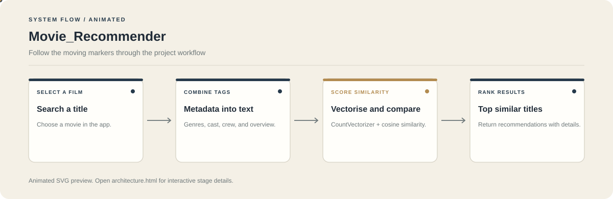

# Movie Recommender

**Discover movies with similar genres, cast, crew, keywords, and plot descriptions.**

This project uses content-based filtering on the TMDB 5000 movie metadata. It combines selected fields into tags, vectorises those tags, and ranks films by cosine similarity.

**Stack:** Python, Pandas, scikit-learn, Streamlit, TMDB 5000 dataset



## How recommendations are produced

1. Select a movie by title.
2. Combine metadata such as genres, cast, director, keywords, and overview into a tag string.
3. Convert tags into a CountVectorizer feature matrix.
4. Compute similarity and return the closest titles, excluding the selected film.

## Features

- Content-based recommendations from movie metadata.
- Searchable movie selection.
- Ranked results with poster and movie details when available.
- Notebook workflow for data preparation and model construction.

## Run locally

```bash
git clone https://github.com/chyk2468/Movie_Recommender.git
cd Movie_Recommender
python -m venv .venv
```

Activate the environment and install dependencies:

```bash
pip install -r requirements.txt
```

Follow the model-preparation steps in `Movie_Recommender.ipynb` if the required artefacts are not present, then launch:

```bash
streamlit run app.py
```

## Files

| File | Purpose |
| --- | --- |
| `app.py` | Recommendation interface |
| `Movie_Recommender.ipynb` | Data preparation and model workflow |
| `tmdb_5000_movies.csv` | Movie metadata |
| `tmdb_5000_credits.csv` | Cast and crew metadata |

## Scope

The recommender is content-based. It does not learn an individual viewer's preferences from watch history or ratings.
